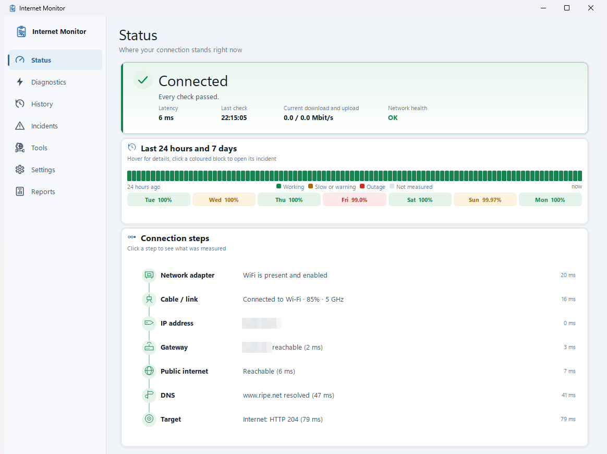
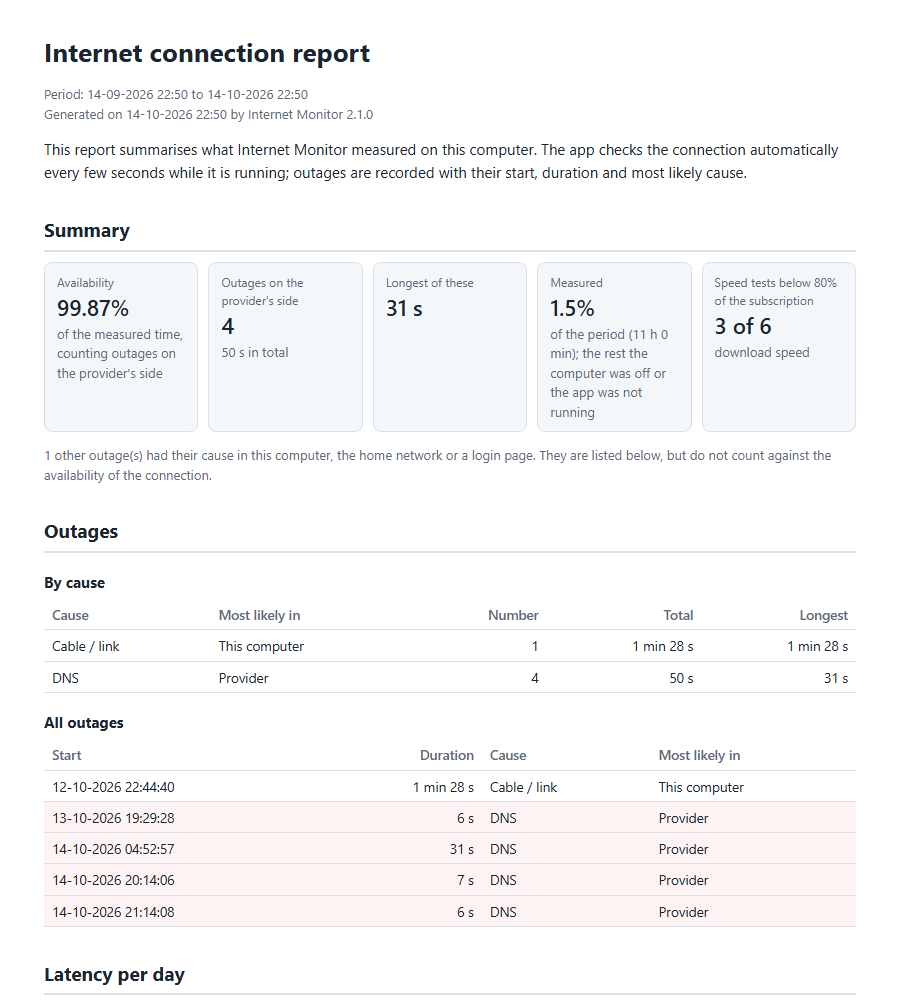
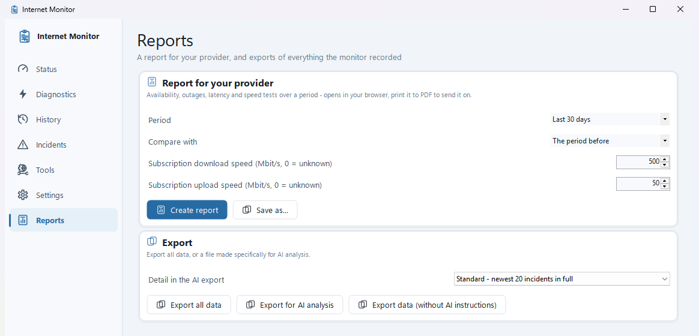

# Internet Monitor

**Is it your Wi-Fi, your router, or your provider? Internet Monitor tells you - and gives you the proof.**

[](https://github.com/DutchCoban/InternetMonitor/releases/latest)
[](https://github.com/DutchCoban/InternetMonitor/releases)

[](LICENSE)

When the internet drops, "it doesn't work" is all you usually have to go on. Internet Monitor sits
quietly in your system tray and checks your connection every few seconds, step by step from your
network adapter out to the wider internet. When something breaks, it tells you in plain language
**where** it broke, **why**, and **what you can do about it** - and it keeps a record of every
outage, so the next time you call your provider you have dates, durations and speed tests instead
of "it's been flaky lately".

**[⬇ Download Internet Monitor](https://github.com/DutchCoban/InternetMonitor/releases/latest)** -
one `.exe`, nothing to install, free and open source.



## Why you'll want it

- **It pinpoints the cause.** Network adapter, cable or Wi-Fi, IP address, router, internet, DNS,
  or one specific service - not just "offline". Seven checks, one plain-language verdict.
- **It gives you evidence for your provider.** One click builds a report with availability, every
  outage and where it most likely originated, latency per day, and your speed tests measured
  against your subscription. Print it to PDF and send it.
- **It understands Wi-Fi.** Signal strength, band, channel and every switch between access points
  - and it tells you when a weak signal, not your provider, is the real problem.
- **It catches what other tools miss.** Lag that only appears when someone is downloading
  (bufferbloat), IPv6 that your provider hands out but that doesn't work, DNS being blocked, pings
  being filtered while the internet works fine, hotel and train Wi-Fi waiting for you to log in, a
  VPN or a phone's hotspot in the way, packet loss and jitter, and a rogue DHCP server on your
  network.
- **It shows the last day at a glance.** A strip on the Status screen colours the last 24 hours
  quarter by quarter and the last seven days with their availability; click a red block to open
  what happened.
- **The tools are built in.** Traceroute that shows who owns every hop, a scan of every device on
  your network, and a speed test with a bufferbloat grade.
- **It's ready for AI.** Export everything as one document, with instructions, to paste into the
  AI assistant of your choice for a second opinion.
- **It respects your privacy.** No account, no telemetry; your data stays on your PC. The AI
  export replaces network names and hardware addresses with stand-ins.
- **It stays out of your way.** A single `.exe` that runs without admin rights, follows Windows'
  light or dark theme, speaks English, Dutch, German and Polish, and can keep itself up to date.

<p align="center">
  
  
</p>

## Get started in a minute

1. **[Download `InternetMonitor.exe`](https://github.com/DutchCoban/InternetMonitor/releases/latest)**
   from the latest release.
2. **Run it.** There is no installer; put the file wherever you like. The app isn't code-signed,
   so Windows SmartScreen may warn the first time - choose *More info* → *Run anyway*.
3. **That's it** - the Status screen opens and monitoring has started. Closing the window keeps
   the app running in the system tray; open it again from the tray icon or by starting the app
   once more. Turn on *Settings → Start automatically with Windows* to keep it running - it then
   starts quietly in the tray when you sign in.

Requires Windows 10 or 11 (64-bit). Nothing else to install - the .NET runtime is built in.

---

The rest of this page describes everything Internet Monitor does in detail.

## What it checks

Every few seconds (3s while a window is open, 15s in the background - see
[Adaptive cadence](#adaptive-cadence)), seven independent probes run and their results are
combined into a single diagnosis, working outward through the network stack so a single failure
is attributed to its most likely cause instead of being reported as a generic "internet is down":

1. **Network adapter** - is an adapter present, operational, and actually carrying traffic?
2. **Cable / link** - does the adapter report a physical link at all? Over Wi-Fi it also reads
   the radio side: network name, access point, signal (% and dBm), band and channel, Wi-Fi
   generation and link rate. Below 40% signal the step becomes a warning, and an outage that starts
   over a weak signal is explained as such (see [Wi-Fi details](#wi-fi-details)). It also says when
   Windows treats the connection as metered - mobile data or a phone's hotspot (see
   [VPN and mobile connections](#vpn-and-mobile-connections)).
3. **IP address** - does the adapter have a usable IPv4 address (vs. an APIPA `169.254.x.x` address, which means DHCP failed)?
   It also shows whether the network offers IPv6 (only the prefix is shown) and whether a VPN is
   active, carrying all traffic or only some.
4. **Gateway** - is the default gateway known and reachable? (Races ICMP and TCP - see below.)
5. **Public internet (multi-endpoint)** - ICMP pings to `9.9.9.9`, `8.8.8.8`, and `1.1.1.1` by default (configurable in Settings → Public internet). They're pinged at once and the first answer settles it - a single unreachable endpoint doesn't mean internet is down, and the step doesn't wait out its timeout; the diagnosis only escalates once none of them respond. With IPv6 on offer, the same resolvers are also pinged over IPv6.
6. **DNS** - can a hostname (`www.ripe.net` by default) actually be resolved by the DNS servers
   this adapter has, obtained via DHCP or set by hand? Those servers are asked directly, and an
   unanswered query is sent once more halfway through the timeout, so one lost packet is not an
   outage. If they fail, the app works down a fixed chain and stops at the first server that
   resolves the name: `9.9.9.9`, then `1.1.1.1`, then `8.8.8.8`, skipping any the adapter already
   uses - if one answers, it's this adapter's DNS server
   that's at fault. A public server that gives no DNS answer is also tried on port 443; reachable
   there but silent on DNS means DNS traffic (port 53) is most likely being blocked. As a last
   resort, up to two DNS servers of your own (Settings → Public internet, optional) are tried. The
   step reports which link in the chain failed or worked.
7. **Target** - a built-in general-reachability check (a `generate_204` endpoint, chosen specifically because it isn't scored/throttled like a normal website behind a CDN - see the doc comment on `CheckTargets.Targets` for why that matters), plus any HTTPS or TCP/UDP port endpoints you've configured in Settings. Every URL target gets a full, per-stage-timed DNS → TCP → TLS → HTTP request. When the built-in check fails, one plain-HTTP request for Windows' own connectivity test page tells a **login page** (hotel, train, guest Wi-Fi) apart from a dead connection - see [Login pages](#login-pages). With IPv6 on offer, one more request goes out over IPv6 - see [IPv6](#ipv6).

All seven steps describe **one path**: the adapter Windows routes internet traffic over is
chosen once per cycle, and steps 4-7 send everything from that adapter's own address and resolve
names through that adapter's own DNS servers. On a machine with several adapters up at once -
say WiFi for internet plus a USB-Ethernet adapter used to configure a switch - the diagnosis
therefore never mixes facts about one adapter with traffic over another. If the chosen adapter
has no way out, step 5 fails ("no internet") instead of a later step failing for a misleading
reason.

Because a network firewall can block ICMP without blocking real traffic, the diagnosis engine
specifically compares ping results against the Target check's results: if ping fails but the
reachability check works, it reports "internet available, ICMP possibly filtered" rather than
claiming the connection is down.

## Adaptive cadence

The check cycle runs every 3 seconds while a window is open and every 15 seconds while only the
tray icon is live (both configurable in Settings → Check interval) - history is always sampled at
the slower, background rate regardless, so retention and chart density don't change depending on
whether you happen to have the window open. History is kept for 30 days by default; Settings →
Check interval offers 7, 30, 60 or 90 days. Incidents are always kept.

## Six screens

- **Status** (left-click the tray icon): a simple green/red/amber overview with a plain-language
  explanation, the last 24 hours in quarter-hour blocks and the last seven days with their
  availability (click a coloured block to open its incident), and a seven-step timeline - is the
  network, internet, DNS, and each configured endpoint working, and which step is being re-checked
  right now?
- **Diagnostics** (right-click → Diagnostics): every probe's raw measurements, the derived
  diagnosis, a network-health summary (see below), the clock check against a time server, and a
  table you can expand per step for exact detail.
- **History**: a zoomable, pannable chart per check (mouse wheel to zoom, drag to pan,
  double-click to reset), switchable between any chartable series and a 15 min/1 hour/6 hour/24
  hour/7 day/30 day/all-time range. Kept for 30 days by default, up to 90. Besides the checks
  themselves this includes the Wi-Fi signal (with a marker wherever you switched to another access
  point), packet loss and jitter, IPv6, this computer's own traffic, and the speed test results.
- **Incidents**: a run of consecutive failed diagnosis cycles (debounced, so a brief blip doesn't
  create noise) grouped into a single incident with a unique ID (`INC-yyyyMMdd-####`), a
  classification, a start/end time, and a snapshot of every probe's result at the start and at
  resolution. Incident text (headline, explanation, step snapshots) is always recorded in English
  regardless of the active display language, so an exported incident reads the same no matter who
  opens it later. A search box and filters narrow the list down by where an incident originated
  (provider, home network, this computer) and when (ongoing, 24 hours, 7 or 30 days). Each
  incident takes a note of your own (a ticket number, what the provider said), and a provider-side
  incident records a traceroute the moment it opens, so its detail shows where the packets stopped.
- **Tools**: a live-filling **Traceroute** (each hop optionally annotated with who owns it - your
  own LAN, your ISP, or a third party, via Team Cymru/RIR lookups, toggleable in Settings - and,
  when ICMP doesn't reach the destination at all, a plain TCP connect to the destination to tell
  "ICMP is blocked" apart from "it's actually down" - see [Known limitations](#known-limitations));
  a **Network scan** of the local subnet (which devices answer a ping, with hostname, MAC address,
  and manufacturer - looked up via two free, alternating MAC-vendor APIs, toggleable in Settings -
  for each; addresses that don't answer a ping also get a TCP-port sweep, toggleable, so a device
  that ignores ICMP but has an open port still shows up - and the scan remembers every device it
  has seen, marks what is new since last time, counts known devices that did not answer, and lets
  you name a device by double-clicking it); a **Speed test** (see below); and a **Path MTU**
  measurement (don't-fragment pings) that tells a normal line (1500), a PPPoE line (1492) and a
  tunnel or VPN in the path apart.
- **Reports**: the [report for your provider](#report-for-your-provider) and the
  [data exports](#exporting-data).

## Wi-Fi details

On a Wi-Fi connection step 2 reads the connection through Windows' Native Wifi API. The History
page charts the signal over time and marks every switch to another access point, and the incident
analysis notices another network, another access point (a roam), and a sharp signal drop (30+
points below the best of the last five minutes). An outage that starts over a weak signal is
explained as most likely caused by that signal rather than by the router or the provider.

Since Windows 11 24H2 the network name and access point count as location data: Windows only
reveals them when location access is on (Settings → Privacy & security → Location). With location
services off, Windows withholds the connection details altogether - but it still reports the signal
strength in dBm and the channel, so the app derives the signal percentage from the first (marked
"≈") and the band from the second. The weak-signal warning and the signal chart keep working; only
the network name and access-point switches are missing. Step 2's details then link straight to the
location settings.

With location access on, step 2 also counts the access points that share your channel and says so
when a 2.4 GHz channel is crowded - the usual reason a Wi-Fi with a fine signal is still slow.

## Login pages

On hotel, train and guest Wi-Fi the network intercepts traffic until you log in. The HTTPS
reachability check then just fails, which says nothing useful. So when it fails, the app requests
`http://www.msftconnecttest.com/connecttest.txt` - the page Windows itself uses for its "action
needed" notice - and if a redirect or a different page comes back, the cause becomes **Login
page**: the Status page says "Login required" (in the warning colour, since nothing is broken) with
an **Open login page** button, and the tray and incident pop-up follow suit. The button opens
Windows' own redirect address, never a link the network supplied. Only a redirect, a 511, or a 200
with the wrong page count as a login page; an interrupted probe is never mistaken for one.

## Latency under load

Every cycle also reads how much traffic this computer's adapter carried since the previous one -
from the adapter's byte counters, so it costs no traffic. When a latency warning coincides with
the line being 70%+ full (judged against the last speed test, else the link speed), the warning
says so: your own downloads queueing in the router (bufferbloat) is a different fix from a slow
provider. Only this computer's traffic is visible; another device filling the line is not.

## Packet loss and jitter

Once a minute, ten pings a tenth of a second apart go to the first public address of step 5. The
share without an answer is the packet loss, and how much the round trip varied from one to the next
is the jitter - the numbers that explain choppy calls and stuttering games on a connection that is
technically up. Both are charted in History and summarised per day in the provider report. A minute
in which nothing came back at all is not recorded: that is an outage (recorded as one) or a network
that filters ping. This runs always, independent of the network-health monitoring below.

## IPv6

Many providers hand out IPv6 next to IPv4. When IPv6 is offered but broken, browsers try it first
and only fall back after a delay, so sites load slowly or only sometimes - a fault that shows
nowhere else. When the adapter has a global IPv6 address, step 5 also pings public resolvers over
IPv6 and step 7 fetches Windows' own IPv6 test page (`ipv6.msftconnecttest.com`). If that fails
while IPv4 works, step 7 becomes a warning with its own cause and advice (restart the router, or
tell the provider). It is not counted as an outage - IPv4 carried on - but the provider report
mentions it. On an IPv4-only network step 3 just says IPv6 is not offered.

## VPN and mobile connections

- **VPN.** Step 3 lists an active VPN and whether Windows routes all internet traffic through it.
  Through a full tunnel, a latency warning says the round trip is via the VPN's server, and an
  internet, DNS or target failure advises trying without the VPN first. A VPN connecting or
  disconnecting is recorded as a change before an incident. The VPN's name never leaves the
  computer: the AI export only says whether it carried all traffic.
- **Metered connections.** Windows marks mobile data and phone hotspots as metered (and you can
  mark a Wi-Fi network as metered yourself). Step 2 says so, automatic speed tests are skipped on
  such a connection unless you allow it in Settings, and a manual test first shows how much data it
  will roughly use. High latency on a metered connection is explained as normal for mobile data.
  The provider report leaves time on a metered connection, and outages that started in it, out of
  the line's availability.

## Network health monitoring

Off by default (Settings → Network health). When enabled, flags packet-level conditions that sit
below what the seven steps measure: TCP retransmissions, packet loss, TTL-exceeded responses, and
an unexpected (rogue) DHCP server on the network - each with its own threshold and time window.

## Speed test

The Tools page's third tab runs a [LibreSpeed](https://librespeed.org/) test (ping, jitter,
download, upload) against a fixed public server - no server picker, to keep this feature's
configuration surface small. While the download and upload run, an ICMP ping to `9.9.9.9` measures
how much the round trip grows with the line full, graded A (under 5 ms extra) to F (200 ms or
more) - the usual bufferbloat scale. "Run now" is always available; Settings → Tools also has an
optional automatic run on a fixed interval (1/2/4/8/12/24 hours, off by default), skipped on a
metered connection unless allowed. Either way, a
result is recorded into History (download, upload, ping and the extra ping under load) and
included in "Export all data" and the provider report.

## Report for your provider

Reports → *Report for your provider* builds one self-contained HTML page for the last 7, 30 or 90 days
and opens it in your browser (print it to PDF to send it on), or saves it. It shows:

- how much of the period was actually measured - time the computer was off or the app not running
  is left out, not counted as up or down;
- availability, counting only outages on the provider's side (the internet beyond the router, the
  provider's DNS); outages in this computer, the home network or a login page are listed
  separately, so the report can't be dismissed over a local problem;
- every outage, and a summary per cause;
- latency per day (average and 95th percentile), and packet loss and jitter per day;
- time spent on a metered connection (a phone's hotspot), which does not count against the line,
  and how often IPv6 failed, if the network offers it;
- every speed test against the subscription speed you enter on the same page, with the extra ping
  under load.

The period is 7, 30 or 90 days, or any number of days up to a year. Optionally the report sets the
period against an earlier one - the period before, the same period a week earlier, or a month
earlier - and shows each headline figure next to its earlier value with the change coloured by
whether it improved.

It contains no network names, addresses or hardware identifiers - only times, durations and speeds.

## Exporting data

Reports → Export covers three kinds of export, and two more are available elsewhere:

- **Export all data** - a zip of settings (redacted), incidents, every history series (including
  ones no chart shows), the diagnostic log, and - as readable documents - the plain data summary
  and the provider report.
- **Export for AI analysis** - one Markdown document with instructions for an AI assistant (what
  to look for, how to structure its answer) and everything the provider report has, plus: every
  incident with its timeline, the changes recorded just before it and each step's measurements;
  when outages start by hour and weekday; latency per day and by hour of day; Wi-Fi signal and
  access-point switches; this computer's traffic; and statistics for every recorded series.
  Wi-Fi network names, access points, MAC addresses and any public IPv4 address this computer
  itself has (a line without NAT) are replaced by stable stand-ins ("Wi-Fi network A", "AP-1",
  "MAC-1", "IP-1"), so it can be pasted into any AI tool. Private addresses, the app's own ping
  targets and resolvers, and the adapter's DNS servers stay as they are - they identify nobody.
- **Export plain data** - the same document without the AI-facing instructions.
- **Per-incident export** - a Markdown report for a single incident, from the Incidents screen.
  Unlike the two exports above this one is *not* pseudonymised, and neither is the zip: both show
  network names, hardware addresses and local addresses as recorded. They are for your own eyes
  or for someone you trust.
- **Network scan → Export CSV** - the LAN scan's device table (IP, hostname, MAC, vendor, response time).

## Settings backup

Settings → Configuration exports or imports this app's own configuration as JSON - separate from
the data exports above, which never include enough to actually restore a setup.

## Checking for updates

Settings → Updates checks GitHub for a newer release once a day by default (configurable), plus a
manual "Check for updates" in the tray menu. Either way, a pop-up reports what it found with a
link to the release page. A separate "Update automatically" toggle (off by default) goes further:
when a newer release is found, it's downloaded in the background, and after a short countdown
pop-up the app replaces itself and restarts on its own.

An automatic install is only ever applied to a download that passes three checks: it is signed with
the project's release key (every release ships `InternetMonitor.exe.sig` next to the executable; the
public key is built into the app), it came from GitHub over HTTPS, and its version resource is the
version the release claims. A release that fails any of these is reported with a link, never
installed. While it waits for the swap, the download sits next to the running executable as
`InternetMonitor.exe.new`.

## Diagnostic logging

Optional, off by default. Configurable levels in Settings → Logging:

| Level | What's recorded |
|---|---|
| Off | Nothing |
| Basic | Status changes and incident open/close events only |
| Extended | + every periodic probe result |
| Full | + verbose details even for successful checks |

Logs are written as JSON Lines to `%AppData%\InternetMonitor\logs\diagnostics.log`, rotated by
size with a configurable number of retained files. A logging failure never interrupts
monitoring. No secrets, tokens, or credentials are ever logged - only connectivity-relevant
technical data (addresses, timings, status codes, error text).

## Configuring application endpoints

Settings → Targets lets you add, edit, enable/disable, and remove any number of application
endpoints, of two kinds:

- **HTTPS** - a full DNS → TCP → TLS → HTTP check against a URL, same as the built-in
  reachability check, with optional custom headers (for an API that needs auth) and an optional
  expected status code.
- **Port (TCP/UDP)** - plain reachability of a host:port, for services that aren't HTTP (a
  database, an internal TCP service, ...). TCP treats both a successful connect and an actively
  refused connection as "reachable" (either proves something answered); UDP is inherently
  ambiguous, so a plain timeout is reported as "uncertain" rather than a false success/failure.

- **Ping** - an ICMP echo to a host, the named ping target of old: the simplest "is it there, and
  how far".

Each enabled endpoint is checked every cycle alongside the built-in checks and shown by name (not
raw URL/host) on the Status screen, and each has its own chart on the History page.

## Uptime Kuma heartbeat

Settings → Integrations lets you configure a push-monitor URL and interval (minimum 60 seconds).
When a URL is set, the app sends a plain periodic `GET` to it - no dependency on any connectivity
check, matching how Uptime Kuma push monitors are normally used. Off by default (no URL
configured). See the [Uptime Kuma project](https://github.com/louislam/uptime-kuma) for what it is
and how to set up a push monitor to get a URL from.

## Webhook

Settings → Integrations → Webhook URL: an https address that receives one JSON `POST` when an
incident opens and one when it closes (`event`, `kind`, `id`, `cause`, `side`, `headline`,
`startUtc`, `endUtc`, `durationSeconds`, `appVersion`). That is enough for Home Assistant, ntfy, a
Discord or Slack webhook, or anything else that takes JSON. A test button sends a sample.

## Pausing

The tray menu pauses monitoring for 30 minutes, an hour, four hours, or until you resume it. Nothing
is measured or recorded meanwhile - a planned router restart does not end up in your history or
your report - and the Status page and the tray tooltip say so.

## Other settings

- **Language** (General) - English, Dutch, German, or Polish. A new installation starts in the
  Windows display language when it is one of these. Switching takes effect immediately across the
  whole app, including an already-open Settings window.
- **Theme** (General) - follows Windows, or forced light/dark.
- **Incident pop-ups** (General) - a notice when a problem is detected and when the connection is
  back, as the app's own pop-up or as a Windows notification.
- **Adapter to monitor** (General) - automatic (the adapter Windows routes over), a preferred
  adapter while it is connected, or always one fixed adapter.
- **Compact widget** (General, or the tray menu) - a small window with the seven steps, the verdict
  and the last fifteen minutes of latency; off by default, draggable, optionally kept on top.
- **Thresholds** (Check interval) - from how many milliseconds latency counts as slow or severe,
  and below which signal quality Wi-Fi counts as weak.
- **Time server** (Public internet) - the NTP server the hourly clock check asks; `pool.ntp.org`
  by default.

## Project status

Internet Monitor is under active development. The current generation, v2 (`src/InternetMonitor/`),
is a ground-up rewrite of the original v1 (kept under `InternetMonitor/` for reference) with a
redesigned interface. Upgrading from v1 is seamless: settings, incident history and per-check
history - including v1's Wi-Fi signal history - carry over automatically.

**New in v2 compared with v1**: an adaptive check cadence; one consistent path through all seven
checks on machines with several adapters; DNS diagnosis that tells your DNS server, blocked DNS
traffic and a dead connection apart; login-page detection; Wi-Fi access-point switches and
weak-signal diagnosis; latency-under-load detection and a bufferbloat grade; packet loss and
jitter; IPv6, VPN and metered-connection awareness; an uptime strip and searchable incidents; a
report for your provider; configurable history retention (up to 90 days); network-health monitoring (TCP retransmissions, packet loss, TTL errors, rogue DHCP);
traceroute hop ownership; LAN-scan manufacturer lookup with a TCP fallback; an AI-ready export;
signed self-update; a webhook; notes on incidents and a route traced when an incident opens; named
ping targets with their own charts; a report over any period with a comparison; adapter choice; a
path-MTU tool; a clock check; a network scan that remembers; a command-line export; a portable mode;
and a compact widget.

Everything v1 did is back. Quiet hours were dropped on purpose: a pop-up suppressed while you are at
the keyboard and shown when you are not would defeat the point - pop-ups can simply be switched off.

Missing something, or found a problem? [Open an issue](https://github.com/DutchCoban/InternetMonitor/issues) -
that's the best way to influence what comes next.

## Project structure

For a new contributor, the call chain from startup to a diagnosis on screen is:

- **`Program.cs`** - entry point. Installs global exception handlers, enforces a single running
  instance (`App/SingleInstanceManager.cs`), then hands off to...
- **`App/AppHost.cs`** - the composition root. Owns the tray icon/menu, loads `AppSettings`, and
  constructs and wires together everything below.
- **`Core/Steps/StepPipeline.cs`** - runs the seven checks under `Core/Steps/Checks/` (see
  `Core/Steps/IStepCheck.cs` for the check/result shape) concurrently every cycle and assembles a
  `StepSnapshot`.
- **`Core/Diagnosis/RootCauseAnalyzer.cs`** - a pure function that walks the snapshot bottom-up
  and returns the single most likely root cause, rather than reporting every failed check as its
  own symptom; `Core/Diagnosis/PlainLanguage.cs` turns that into the headline/explanation shown on
  screen.
- From there, `Core/Incidents/IncidentTracker.cs` turns a run of failing cycles into a tracked
  `Incident` (persisted via `IncidentStore`), `Core/Diagnosis/DiagnosticLogger.cs` optionally
  writes a detailed JSONL log, and the `Ui/Shell/Pages/` screens render the result - everything
  crossing from a background thread onto the UI thread is marshalled via `SynchronizationContext`.

Besides the main cycle, a handful of things run on their own schedule: `Core/Monitors/KumaPusher.cs`
(the heartbeat push), `Core/Monitors/LineQualitySampler.cs` (packet loss and jitter, once a minute),
`Core/Monitors/NetworkHealthMonitor.cs` (packet-level conditions),
`Core/Updates/UpdateChecker.cs` (the daily GitHub check), `Core/Monitors/SpeedTestScheduler.cs`
(the optional automatic Speed Test) - the last four follow the same `Reconfigure(...)`-driven
live-restart shape, so a Settings change takes effect immediately without restarting the app.
Traceroute (`Core/Tools/Traceroute/`), the LAN scanner (`Core/Tools/LanScan/`) and the Speed Test
itself (`Core/Tools/SpeedTest/`) are the genuinely on-demand tools, triggered only from the Tools
page (the Speed Test's own client is also what the scheduler above calls headlessly).

All user-facing text (including diagnosis headlines/explanations) goes through
`Localization/LocalizationManager.cs`, loading `Localization/{en,nl,de,pl}.json` - four languages,
switchable live from Settings; there is no hardcoded UI language anywhere in the check/diagnosis
layer. Every colour, spacing step, corner radius and font comes from `Ui/Theming/Theme.cs` - no
control names a color of its own.

## Building and running

Requires the .NET 10 SDK (`winget install Microsoft.DotNet.SDK.10`).

```powershell
dotnet build InternetMonitor.sln
```

Publish a single self-contained `.exe` (no .NET runtime needed on the target machine):

```powershell
dotnet publish src/InternetMonitor/InternetMonitorV2.csproj -c Release -r win-x64 --self-contained true `
  -p:PublishSingleFile=true -p:EnableCompressionInSingleFile=true -o ./publish
```

The result, `publish/InternetMonitor.exe`, can be copied to and run on any Windows 10/11 x64
machine. This intentionally skips `PublishReadyToRun` (which roughly doubles framework assembly
sizes by embedding precompiled native code) to keep the download small - a slightly slower JIT
cold start is an easy trade for a tray app that starts once and runs for days.

### Signing a release

The self-update refuses anything not signed with the release key, so a release needs its
signature asset. `tools/ReleaseSigner` (plain .NET, no packages) makes it:

```powershell
dotnet run --project tools/ReleaseSigner -- sign <path-to-private-key.pem> ./publish/InternetMonitor.exe
```

That writes `publish/InternetMonitor.exe.sig`, which is uploaded next to the executable. The
private key lives with the maintainer, outside the repository; `keygen` makes a new pair and prints
the public half to put in `Core/Updates/ReleaseSignature.cs`. Anyone can check a download by hand
with `verify <public-key-base64> <path-to-InternetMonitor.exe>` (the `.sig` is expected next to it).

### Command line

```powershell
InternetMonitor.exe --export report C:\reports\this-week.html   # also: zip, ai, plain
InternetMonitor.exe --selftest C:\temp\selftest.txt
InternetMonitor.exe --trace 9.9.9.9
```

`--export` writes one of the Reports page's exports without opening a window, from the same stored
settings, history and incidents, and works while the app is running - for a scheduled task that
mails the provider report every Monday, say. The exit code is 0 on success.

## Settings and data locations

- Settings: `%AppData%\InternetMonitor\settings.json` (the same file v1 used - an existing
  installation's settings are picked up automatically)
- Diagnostic log: `%AppData%\InternetMonitor\logs\diagnostics.log` (+ rotated `.log.1`, `.log.2`, ...)
- Incident history: `%AppData%\InternetMonitor\incidents.json`
- Per-check history (the History screen's charts): `%AppData%\InternetMonitor\history\`
- Cached lookups (traceroute hop ownership, MAC vendors): `%AppData%\InternetMonitor\cache\`

None of these live inside the application directory, so the app itself can be replaced/updated
(by hand, or via the self-update feature above) without touching configuration or history.

**Portable mode:** put an empty file named `portable.txt` next to `InternetMonitor.exe` and
everything above lives in a `data` folder next to the executable instead - for a USB stick or a
shared tools folder. The `INTERNETMONITOR_DATA_DIR` environment variable, when set, wins over both.

## Known limitations

- Gateway reachability races a plain ICMP ping against a TCP connect attempt to a few common
  ports (80/443/53), all at once - whichever answers first wins - so it works both on networks
  where ICMP is fine (the common case) and ones that filter it, without waiting through both in
  sequence. A gateway that answers neither will still read as unreachable, but that combination
  is rare in practice. This check has no retry: a network settings change (even just the DNS
  server) can make the gateway genuinely unreachable at the OS level for a few seconds, and
  that's real, momentary state worth showing, not a measurement error to hide.
- Wi-Fi network names and access points need location access on Windows 11 24H2 and later - see
  [Wi-Fi details](#wi-fi-details). Without it, the band comes from the channel number, which
  cannot tell a 6 GHz channel from a 2.4 or 5 GHz one with the same number.
- The IPv6 check needs `ipv6.msftconnecttest.com` to resolve; a DNS server that withholds AAAA
  records leaves IPv6 untested rather than reported as broken (browsers then don't try IPv6
  either).
- "The line was busy" only sees this computer's traffic; another device filling the line looks like
  an idle line from here.
- The DNS step queries the adapter's DNS servers directly over plain UDP port 53, not through
  Windows' own resolver. That's what lets it test exactly that adapter's servers and report which
  one answered, but it also means a setup that only resolves through Windows' encrypted DNS
  (DNS over HTTPS) with plain DNS blocked gets a warning rather than a failure: when no server
  answers plain DNS, the step asks Windows' own resolver, and when that resolves the name it says
  so instead of calling DNS broken. An adapter that has no DNS server at all is reported as exactly
  that.
- Application endpoints are entirely user-configured with no target allowlist, by design (this
  is a local, single-user tool) - see [Security notes](#security-notes) below.
- The self-update only installs a release that carries both `InternetMonitor.exe` and
  `InternetMonitor.exe.sig`, exactly so named. A release missing either is reported with a link
  but never installed; so is one whose signature or version does not check out.
- Traceroute does not fall back to a real TCP-based traceroute when ICMP is blocked. A genuine
  per-hop TCP traceroute needs a raw socket to catch the ICMP "Time Exceeded" replies a TCP probe
  provokes, and raw sockets need administrator rights on Windows - more than this app's deliberately
  unelevated (`asInvoker`) model is worth changing for one tool. Instead, when the ICMP trace
  doesn't reach the destination, one plain TCP connect straight to the destination (port 443, then
  80) tells you whether it's ICMP that's blocked or the destination that's actually unreachable -
  not which routers are in between.

## Security notes

- **User-configured targets are trusted.** Application endpoints are entirely user-supplied and
  flow directly into raw TCP/UDP/HTTPS probes with no target allowlist. This is intended - it's a
  local, single-user monitoring tool, and you're only ever pointing it at hosts you choose. It
  does mean that importing a settings file you don't trust would let it probe whatever hosts that
  file names.
- **Endpoint URLs can end up in incident/log files.** If a monitored endpoint's URL embeds a
  secret (an API key or webhook token in the query string, for example), that full URL is
  captured verbatim into `incidents.json` and, if detailed diagnostic logging is enabled, into
  `diagnostics.log`. Avoid putting secrets directly in monitored URLs, or keep detailed logging
  off for such endpoints. The Uptime Kuma push URL is handled separately and is never logged.
- **TLS validation is never bypassed.** Every HTTPS check uses .NET's default certificate
  validation with no custom callback.
- **What comes back from the network is data, not instructions.** A DNS reply is accepted only
  when it is a reply to the question that was asked, not merely one carrying the right transaction
  id; answers from the lookup services are read up to a fixed size; a link from GitHub's release
  feed is opened only when it is an HTTPS address on github.com; and CSV exports write a host name
  or manufacturer that starts like a spreadsheet formula (`=`, `+`, `-`, `@`) as text.
- **The rogue-DHCP check shares a port with Windows.** When that network-health condition is on
  (it is off by default), every poll binds UDP port 68 next to Windows' own DHCP client for about
  three seconds and broadcasts a DHCP discover with a made-up hardware address. In that window a
  reply meant for Windows can land in the app instead (the DHCP client then simply retries), the
  real DHCP server briefly reserves an address for a device that does not exist, and a switch with
  DHCP snooping may log the packet. The default interval is fifteen minutes; leave the condition
  off unless you want to know about a second DHCP server.
- **The Uptime Kuma push URL is only ever called over HTTPS.** It carries the monitor's token, so a
  plain `http://` URL - even one placed in `settings.json` by hand or by import - is treated as "no
  URL" rather than sent in the clear.
- **Several features send third parties something about your network, each with its own
  off switch.** Traceroute's hop-ownership lookup sends hop IP addresses to Team Cymru and the
  regional internet registries (toggleable in Settings → Tools); the LAN scanner's manufacturer
  lookup sends each device's MAC prefix - never the full address - to macvendorlookup.com and
  macvendors.com (same toggle group); and the update checker sends nothing but a plain request to
  GitHub's public release API. All three are on by default except where noted, and every one is
  switchable. When the reachability check fails, the login-page probe requests Microsoft's
  connectivity test page - the same request Windows makes itself.
- **Speed Test moves real data to a third-party server.** Unlike every other check, a speed test
  (manual or automatic) transfers real download/upload traffic to a public LibreSpeed server, not
  just small probe packets. It never runs unless "Run now" is clicked or the automatic interval is
  explicitly turned on in Settings, and the automatic interval can't be set below 1 hour.
- The app runs unelevated (`asInvoker`, see `app.manifest`) and only ever talks outbound over
  the network - it opens no listening ports and requires no special permissions, except that the
  optional self-update feature replaces its own executable file on disk.
- **The self-update installs only what the maintainer signed.** See [Checking for
  updates](#checking-for-updates): signature, origin and version are all checked before the swap,
  the swap helper is Windows PowerShell started by its full system path, and the download never
  passes through the temp folder.

## License

MIT - see [LICENSE](LICENSE). Internet Monitor is an independent open-source project, not
affiliated with or endorsed by any company; no organisation's endpoints or branding are built in.
